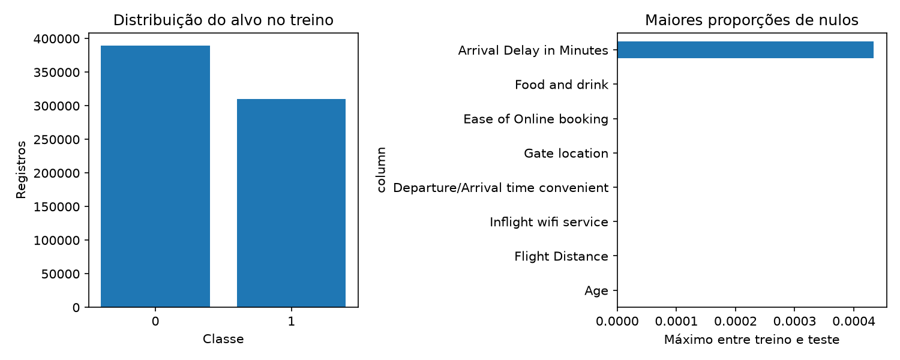

# Resultados e limitações

## Competição S6E10

| Etapa | Estado |
|---|---|
| Sample inspecionado | Concluído, 299.844 registros |
| Treino e teste oficiais localizados | Concluído: 699.635 / 299.844 registros |
| Auditoria da base oficial | Concluída, sem duplicatas exatas ou IDs sobrepostos |
| Piloto com dados oficiais | Concluído: 10 mil linhas, 83,33 s |
| Baseline e OOF oficiais | Treino completo em execução, 5 folds |
| Submissão real gerada | Pendente |
| Envio ao Kaggle | Não realizado |
| Aceitação com score | Não observada |
| Execução em Colab | Não realizada |

O piloto obteve AUC OOF de 0,95347198 apenas na amostra de 10 mil linhas; o resultado
da validação completa ainda está em processamento. Não existe nota pública medida no Kaggle.
As notas dos notebooks de terceiros estão em [references.md](references.md) e não entram
na comparação de experimentos próprios.

## Auditoria dos dados oficiais

O treino possui 310.339 registros positivos (`True`) e 389.296 negativos (`False`).
Há 292 nulos no atraso de chegada no treino e 130 no teste. Zeros, categorias e
outliers foram preservados. Todas as categorias do teste aparecem no treino.

Relatório agregado: [competition_data_audit.json](../reports/competition_data_audit.json).
Em dez faixas consecutivas de ID, a prevalência varia de 44,18% a 44,61%.
O ID permanece excluído das features; essa verificação não substitui a investigação
de grupos ou tempo quando houver variáveis que os representem.

## Referência externa auditada

O arquivo local auditado tem 129.880 registros, 22 colunas e alvo booleano:
56.428 `True` e 73.452 `False`. Há 393 valores ausentes em `Arrival Delay in Minutes`.
Não foram encontradas linhas ou vetores de features exatamente duplicados.

Os atrasos máximos são 1.592 e 1.584, incompatíveis com a descrição de notas 0–5.
O relatório agregado e o hash do arquivo estão em
[external_reference_audit.json](../reports/external_reference_audit.json).
Esse arquivo não foi usado para treinar modelos de competição.

## Verificação funcional

Os testes usam dados artificiais, com nulos, categorias, IDs fora da ordem do sample,
duplicatas e entradas incompatíveis. São verificadas integridade dos folds, reutilização,
rejeição de adulteração do cache, cobertura OOF e leitura da submissão gravada.

Verificações executadas localmente:

- **32 testes aprovados**, incluindo treinos pequenos dos três backends. Última execução:
  13,26 segundos. Nenhum aviso nessa execução.
- Ruff: verificação estática aprovada.
- Smoke pela CLI: concluído com 240 registros de treino, 31 de teste e 3 folds.
  O arquivo gravado foi reaberto e validado. Estado registrado: `diagnostic_only`.
- Tentativas com os dados oficiais ausentes e com os CSVs incompatíveis de Downloads:
  rejeitadas com mensagens explícitas antes do treino.
- Verificação de publicação: nenhum dado individual ou segredo detectado pelos padrões
  configurados. Essa verificação não constitui garantia absoluta de ausência de segredos.

- Notebook executado em kernel local Python 3.12, incluindo instalação/configuração,
  checkout identificado e smoke test. A cópia executada fica apenas em
  `artifacts/notebook-qa/executed-local.ipynb`, ignorada pelo Git; a versão publicada
  permanece sem saídas. O caminho remoto Colab ainda não foi executado.
- Gráfico da auditoria artificial gerado e inspecionado visualmente.
- Código e documentação publicados por push confirmado no repositório público
  [EduardoTostesC/airline-satisfaction-ml](https://github.com/EduardoTostesC/airline-satisfaction-ml).
- [GitHub Actions em Ubuntu/Python 3.12](https://github.com/EduardoTostesC/airline-satisfaction-ml/actions/runs/41002072666)
  aprovado no commit `1b91244`: instalação, Ruff, testes e verificação de publicação.
  O CI instala o lock principal; os extras LightGBM e XGBoost são verificados localmente.

Scores e tempos artificiais não são benchmarks de desempenho da S6E10.
